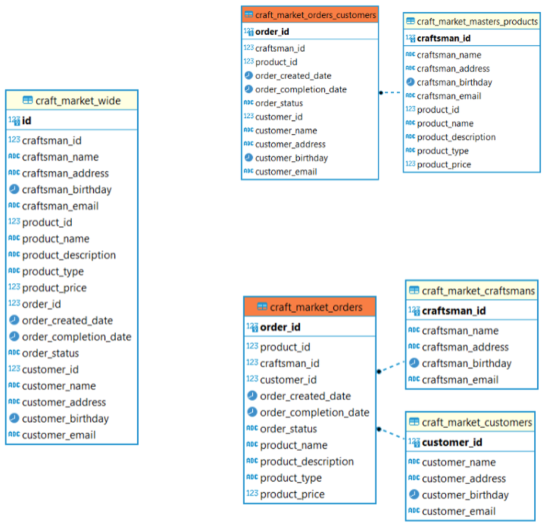
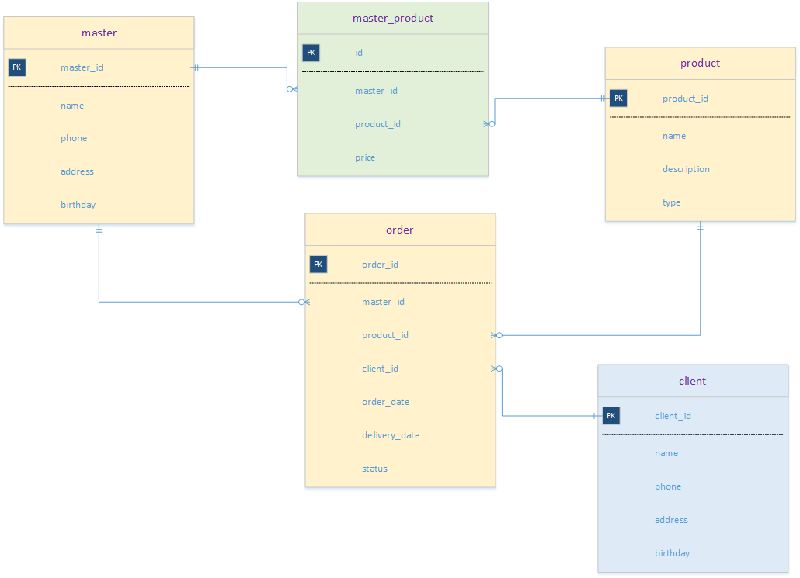

# Original task statements

Verbatim text and tables extracted from `assignment-v1.docx`. Embedded source diagrams are preserved alongside this file.

Задание 1. Модель данных

craft_market_masters_products – таблица мастеров и товаров

craft_market_orders_customers – таблица заказчиков и заказов

craft_market_craftsmans – таблица мастеров 

craft_market_customers – таблица заказчиков 

craft_market_orders – таблица заказов с товарами

Напишите запрос 

 идентификатор записи;

 идентификатор заказчика;

 Ф. И. О. заказчика;

 адрес заказчика;

 дата рождения заказчика;

 электронная почта заказчика;

 сумма, которую потратил заказчик;

 сумма, которую заработала платформа от покупок заказчика за месяц (10% от суммы, которую потратил заказчик);

 количество заказов у заказчика за месяц;

 средняя стоимость одного заказа у заказчика за месяц;

 медианное время в днях от момента создания заказа до его завершения за месяц;

 самая популярная категория товаров у этого заказчика за месяц;

 идентификатор самого популярного мастера ручной работы у заказчика. Если заказчик сделал одинаковое количество заказов у нескольких мастеров, возьмите любого;

 количество созданных заказов за месяц;

 количество заказов в процессе изготовки за месяц;

 количество заказов в доставке за месяц;

 количество завершённых заказов за месяц;

 количество незавершённых заказов за месяц;

 отчётный период, год и месяц.

Задание 2:

Отдельная новая схема external_source, которую нужно подключить к хранилищу.

customer_research — данные маркетинговых исследований,

user_order_log — логи статусов заказов пользователей,

user_activity_log — логи поведения пользователей.

Пусть есть три файла:

user_order_log.csv; ; id; uniq_id ; date_time ; city_id ; city_name ; customer_id ; first_name ; last_name ; item_id ; item_name ; quantity; payment_amount | user_activity_log.csv; Id; uniq_id ; date_time ; action_id ; customer_id ; quantity ;  | customer_research.csv; date_id ; category_id ; geo_id ; sales_qty ; sales_amt ; 

Необходимо файлы разложить по таблицам

Таблица user_order_log:; Date_time ; Customer_id ; Quantity; Payment_amount ;  | Таблица user_activity_log:; Date_time ; Customer_id ;  | Таблица customer_research:; Date_id ; Geo_id ; Sales_qty ; Sales_amt ; 

Предлагаю использовать docker compose

Задание 1. Модель данных магазин изделий ручной работы

master_product – таблица мастеров и товаров

master – таблица мастеров 

client – таблица заказчиков 

order – таблица заказов

Напишите запрос 

 идентификатор записи;

 идентификатор заказчика;

 Ф. И. О. заказчика;

 адрес заказчика;

 дата рождения заказчика;

 электронная почта заказчика;

 сумма всех оплаченных заказов клиента;

 количество заказов у заказчика за месяц;

 средняя стоимость одного заказа у заказчика за месяц;

 медианное время в днях от момента создания заказа до его завершения за месяц;

 самая популярная категория товаров у каждого заказчика за месяц;

 идентификатор самого популярного мастера у заказчика. 

 количество созданных заказов за месяц;

 количество заказов в процессе изготовления за месяц;

 количество завершённых заказов за месяц;

 количество незавершённых заказов за месяц;

 отчётный период - год и месяц.

Задание 2:

Отдельная новая схема external_source, которую нужно подключить к хранилищу.

marketing_research — данные маркетинговых исследований,

order_statuses — данные о статусах заказов пользователей,

user_behavior — данные о поведении пользователей.

Пусть есть три файла:

order_statuses.csv; ; id; date_time ; city_id ; city_name ; client_id ; first_name ; last_name ; item_id ; item_name ; quantity; payment_amount | user_behavior.csv; Id; date_time ; behavior_id ; user_id ; quantity ;  | marketing_research.csv; date_id ; category_id ; sales_qty ; sales_amt ; 

Необходимо файлы разложить по таблицам

Таблица order_statuses:; Date_time ; Client_id ; Quantity; Payment_amount ;  | Таблица user_behavior:; Date_time ; client_id ;  | Таблица marketing_research:; Date_id ; Sales_qty ; Sales_amt ; 

Задание 3

В «logs» сохраняются все изменения, которые внесли в другие таблицы БД

Например:

3 | 18.04.2024 22:40:18.143 | category | { " category_id": "1", "category_name": "gold", "percent": 0.3,; "min_payment": "100 000"; }

7 | 21.04.2024 04:40:18.308 | order      | {"order_id": 46, "client_id": 1040, …… }

В MongoDB положим три коллекции (clients, orders, restaurant)

Restaurant

{

  "_id": ObjectId("n856785vnh4n458nrf"),

  "name": "Отличная курочка",

  "phone": "5444485",

  "email": "hen@mail.ru",

  "founding_day": "30.04.2014",

  "address": "……"

}

Clients

{

  "_id": ObjectId("n856785vnh4n458nrf"),

  "name": "Иванова Инна Ивановна",

  "phone": "5824585",

  "email": "iii@mail.ru",

  "birthday": "30.04.2014",

  "login": "iii",

-- поле для доставки, можно не заполнять   

“address”: {

        city: "СПб",

        street: "Московский пр",

        building: "12"

    }

  "update_time": "30.04.2024 15:22:55"

}

 Orders

{

  "_id": ObjectId("n856777vnh4n458nrf"),

  "restaurant_id": 1,

  "order_id": 11,

  "order_date": "2026-03-14T13:37:27+00:00",

  "client_id": 1,

  "ordered_dish": Array(2),

  "payed_by_bonuses": 0,

 "cost": 27,

 "payment": 27,

 "bonus_for_visit": 2,

"final_status": "closed"

  "update_time": "30.04.2024 15:22:55"

}                                                                                                                                                                                                                                                                                                                                                                                                                                                                                                                                                                                                                                                                                                                                                                                                                                                                                                                
